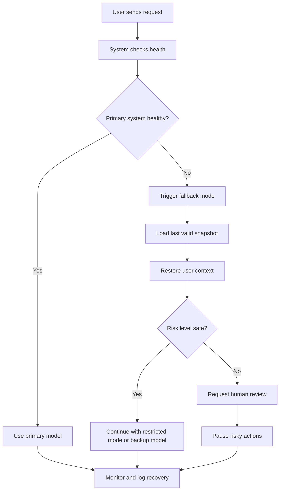

# Failover and Recovery Flow

## What this document explains

This guide explains what happens when an AI chatbot or LLM system encounters a failure.

The goal is not only to keep the service running, but to recover in a safe, predictable, and understandable way.

## Typical failure scenario

A user is chatting with the assistant, and then one of these happens:

- the primary model is unavailable
- the runtime is down
- the system loses memory or context
- a tool call fails
- the assistant produces bad output and must be stopped

## Recovery flow

## Step-by-step

### 1. Detect the issue
The system notices a problem such as:

- timeout
- model outage
- rate limiting
- missing state
- context corruption

### 2. Freeze risky work
The platform should avoid firing risky actions while the recovery process is running.

This protects the system from making incorrect or dangerous changes.

### 3. Load the last known-good state
The system restores the latest valid session snapshot, user state, or conversation checkpoint.

### 4. Activate fallback path
The system may switch to:

- a second provider
- a safer model
- a rule-based response path
- a restricted mode with fewer actions

### 5. Ask for human review if needed
If a task is sensitive, high-impact, or irreversible, a human should confirm before continuing.

### 6. Log the incident
The system records:

- what failed
- what state was restored
- what fallback was used
- whether the recovery succeeded

## Why this matters

Without a defined recovery flow, the system may:

- continue with corrupted context
- lose user trust
- run unsafe automation
- create inconsistent behavior

With a defined flow, recovery is predictable and safer.

## Final summary

A strong AI system must be able to say:

- I detected a problem
- I know what the user was doing
- I restored the latest valid state
- I switched to a safe path
- I logged the event and kept the system under control

That is the heart of failover and recovery design.
